# Crabminer — feature guide

A tour of the game in pictures: what the player does from the first screen to Crab Tycoon, what each feature is, why it exists, and how it fits the whole. The pictures were taken by `scripts/feature-guide.js` on 2026-10-20, playing the committed game (`eda12f2`) in headless Chromium at 1280×800, with numbered rings drawn over what each picture is about. The numbers in the text are the ones that were on the screen. The rules themselves, with every constant, are in [RULES.md](RULES.md); how the code is built is in [ARCHITECTURE.md](ARCHITECTURE.md).

> **What the game is.** Crabminer is a small city builder on a layered paper-dune sea floor. You run a crew of robot crabs that turns buried metal into money: scouts flag deposits, drills dig them up, haulers carry the nodules to an ore pile, crushers press them into bars, smelters melt the bars into ingots in a lava cave, and a riser sends the ingots up to a ship. Every ingot sent up earns credits, and lifetime earnings climb six ranks to Crab Tycoon, which wins. No crab takes orders: each follows a simple rule, and you balance the crew. It is one static page with no build step and no dependencies.

**What was played, and what was not.** Parts 1 to 8 are plain play through the page's own buttons and keys: a new game, the tutorial's steps in order (a second smelter, the hires the advisor named, overclock, A and B shifts, the middle dune), then research, from 0 to 865 seconds of crab time (day 5). The octopus, the trader, the storm, the turtle, the ship orders and the rival crew came on their own timers. Four things were not plain play, and the pictures that show them say so:

- **Time.** Frames stall on a headless page (a few a second once the sea is busy), so time moved on through `crabminer.advance()`, which steps the view's own `update()`, as `tests/browser.js` does. The game itself does not know the difference.
- **The late game** (part 9) was reached by adding 6,000 credits and buying the upgrades through `crabminer.sim.buy()` and `hire()`.
- **The festival and the four pets** (part 10) were called up with the debug hooks `crabminer.festival()` and `crabminer.adopt()`, and the win (part 12) by setting lifetime earnings to 5,990, so the next sale made Crab Tycoon.
- **Emoji.** The VM has no emoji font, so the crabs spell their talk in words ("ore done yay", "hole no meh"), as the game does on any device without emoji, and a few symbols (the 🎓 apprentice button, the achievement badges, some bubbles) show as empty boxes. On a normal browser they are emoji.

## Contents

1. [A new game: the screen and the tutorial](#part-1)
2. [The line: from sand to ship](#part-2)
3. [The crew: eight kinds, hired by hand](#part-3)
4. [Money: selling up the riser](#part-4)
5. [The workday: shifts, rest and the night](#part-5)
6. [Upkeep: power, breakdowns and repairs](#part-6)
7. [The sea joins in](#part-7)
8. [Growing: the Build and Tech tabs](#part-8)
9. [The late game: more ground, a longer line](#part-9)
10. [The crabs' lives: festivals, pets, moods and talk](#part-10)
11. [The Ledger: finding the slowest stage](#part-11)
12. [Crab Tycoon, and a new dig site](#part-12)
13. [The paper under the game, and the controls](#part-13)
14. [How it fits together](#part-14)

## 1. A new game: the screen and the tutorial

**Why it exists.** A city builder with eight kinds of worker and a dozen systems can bury a new player. The game starts already running (nine crabs, 120 credits, the line mining) and puts one instruction on the screen at a time, so the first minutes teach by doing.

**How it fits.** Everything after this is the loop the tutorial names in its closing note: feed the slowest stage, keep every job covered on every shift, and let the crabs rest and dance.

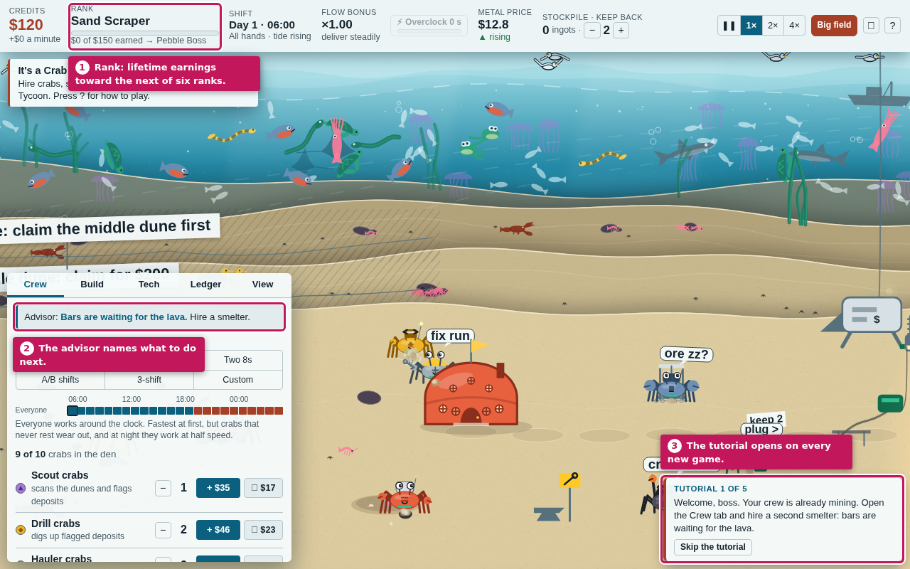

*A new game: the top bar, the panel, and the tutorial's first step.*

1. Rank: lifetime earnings toward the next of six ranks.
2. The advisor names what to do next.
3. The tutorial opens on every new game.

The top bar carries credits and the rate a minute, the rank, the shift clock (day, hour, workday and tide), the flow bonus, overclock, the metal price, the stockpile with the ingots kept back, and the speed (pause, 1×, 2×, 4×). The panel has five tabs: Crew, Build, Tech, Ledger and View. The game saves itself in the browser every 10 seconds and when the page is hidden, so a reload carries on where it stopped.

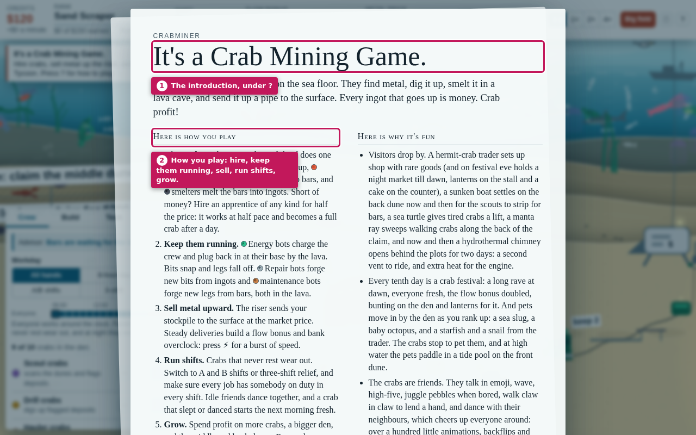

*The introduction, under ?.*

1. The introduction, under ?
2. How you play: hire, keep them running, sell, run shifts, grow.

The introduction is the whole game in two columns: how you play, and why it is fun. Below them are the buttons to start (or carry on), Listen all (the page reads itself aloud), Tutorial, and New game once a game is under way. The tutorial has six steps: hire a second smelter, follow the advisor, overclock, try A and B shifts, claim the middle dune, then a closing note. Each moves on by itself when it is done.

**Check yourself**

- [ ] Before hiring anything, read the advisor. It names the slowest stage, or the overhead that is short.

## 2. The line: from sand to ship

**Why it exists.** The game is about a production line you can watch come together. Every stage is a crab doing one visible thing, so a bottleneck is something you can see: nodules piling up on the sand, an empty bar stack, smelters standing about.

**How it fits.** Each stage feeds the next, and the slowest one sets the pace of the whole line. The rest of the game (hiring, upgrades, research, shifts) is about raising that slowest stage.

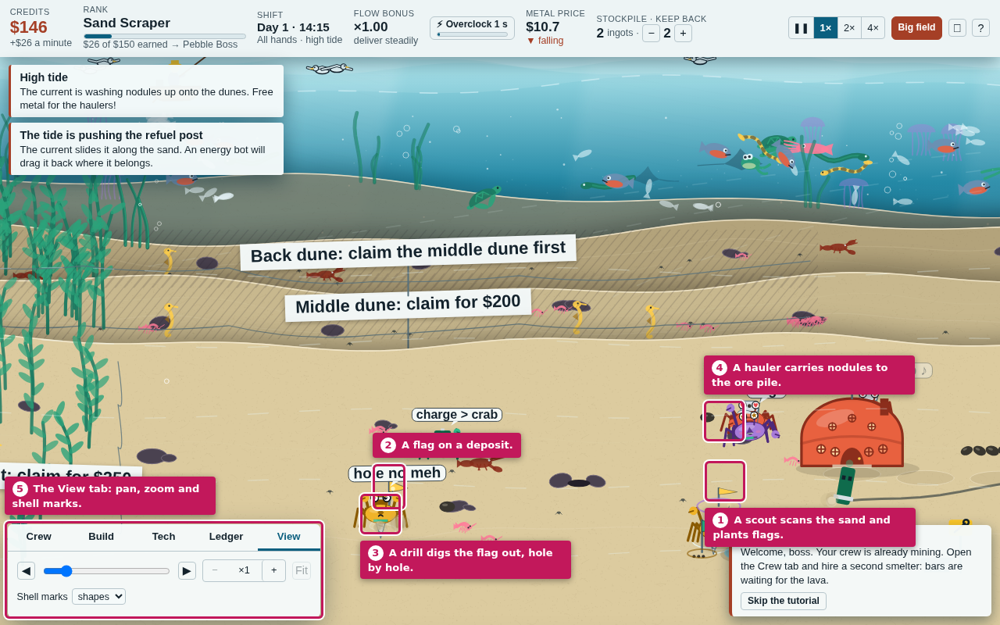

*The field: scouts, flags, drills and haulers.*

1. A scout scans the sand and plants flags.
2. A flag on a deposit.
3. A drill digs the flag out, hole by hole.
4. A hauler carries nodules to the ore pile.
5. The View tab: pan, zoom and shell marks.

A scout walks to a spot on the claimed dunes, scans for 3.4 s, and finds a deposit half the time. A flag carries a richness (the chance a hole strikes) and a size (how many nodules it holds). A drill picks the flag that best repays the walk and drills it until it is empty: a hole takes 2.8 s and can come up dry. Haulers fetch the nodules three at a time and stack them on the ore pile. The world is a track 1,000 units long and three dunes deep; only the front dune is claimed at the start.

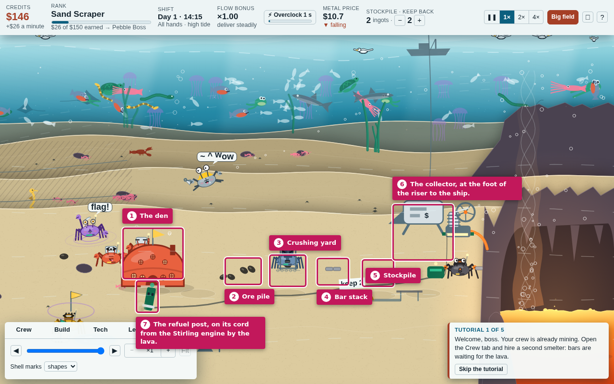

*The plots: the den and the processing line, to the lava.*

1. The den
2. Ore pile
3. Crushing yard
4. Bar stack
5. Stockpile
6. The collector, at the foot of the riser to the ship.
7. The refuel post, on its cord from the Stirling engine by the lava.

A crusher presses two nodules into a bar in 4.5 s. A smelter carries a bar to the lava rim, holds it in the lava for 3.0 s, and carries the ingot to the stockpile. The riser sends one ingot up every 3.0 s. The buildings stand on seven plots that can be rearranged (part 8), because shorter walks between them mean more metal.

**Check yourself**

- [ ] Find the pile that is growing. The stage after it is the one that is short.

## 3. The crew: eight kinds, hired by hand

**Why it exists.** Hiring is the main lever. Each kind does one job, so the crew's make-up is the line's shape, and each extra crab of a kind costs 15% of the base price more than the last, so you cannot simply buy your way past a bad balance.

**How it fits.** The advisor and the Ledger (part 11) say which kind is short; the den limits how many crabs there can be, which makes the Crab den upgrade (part 8) part of hiring.

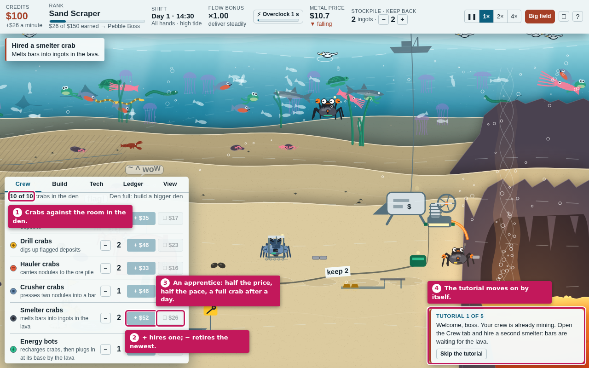

*The Crew tab, after the tutorial's first hire.*

1. Crabs against the room in the den.
2. + hires one; − retires the newest.
3. An apprentice: half the price, half the pace, a full crab after a day.
4. The tutorial moves on by itself.

The second smelter filled the den (10 of 10, and the panel says "Den full: build a bigger den"), so the + buttons went grey. In this run the next hires were the ones the advisor named once the den was bigger: an energy bot (power was short), then a maintenance bot (crabs were limping on missing legs). The eight kinds are scout, drill, hauler, crusher, smelter, energy bot, repair bot and maintenance bot. Each has its own colour and gear and a mark on its shell (▲, ◆, two bars, ■, ●, a bolt, +, ○), so no two kinds are told apart by colour alone. An apprentice is the early game's cheap hire: it works and walks at half pace in a yellow paper cap and graduates after one day (180 s), keeping its name and record.

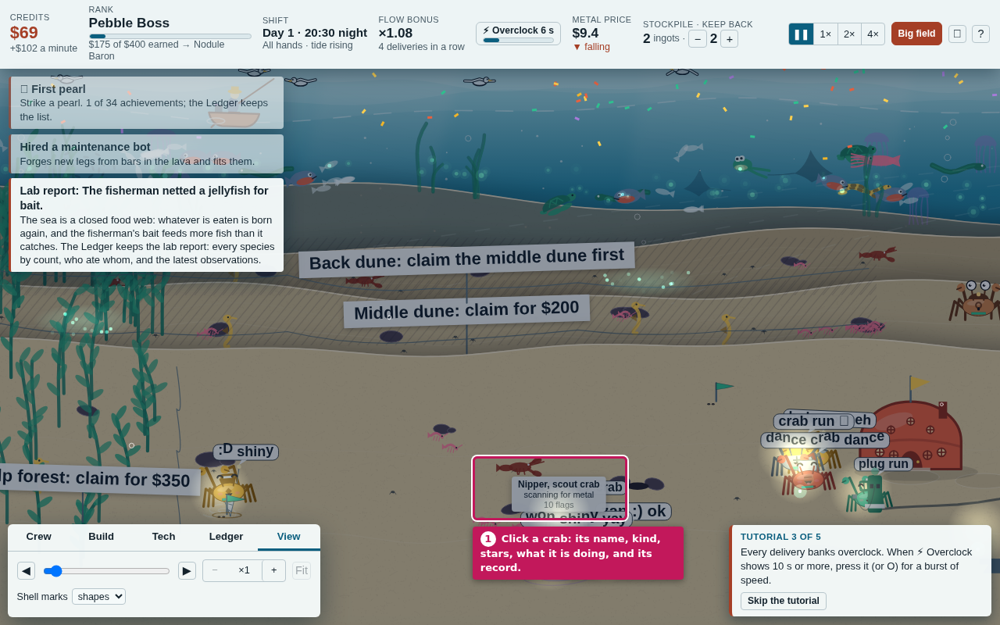

*A crab's card, opened by a click on the crab.*

1. Click a crab: its name, kind, stars, what it is doing, and its record.

Every crab has a name and a record: here Nipper, a scout, scanning for metal, with 10 flags planted. A crab that does enough of its own job earns a star, up to three, and each star makes it 5% faster at that job; retiring always takes the newest crab of a kind, so veterans stay (in picture 7 a toast announces the first: "Whelk is a veteran hauler ★"). The crew is also listed by name in the Crew tab, with Show to find a crab, for anyone who cannot click the field.

**Check yourself**

- [ ] Hire for the stage the advisor names, not the one that looks busiest.
- [ ] Short of credits early? An apprentice costs half.

## 4. Money: selling up the riser

**Why it exists.** The price moves, so when you sell matters; and steady selling is rewarded, so a balanced line earns more than a bursty one with the same output.

**How it fits.** Credits buy crabs, upgrades and research, and lifetime earnings set the rank. The stockpile reserve ties money to upkeep: ingots kept back are the raw material for repairs (part 6).

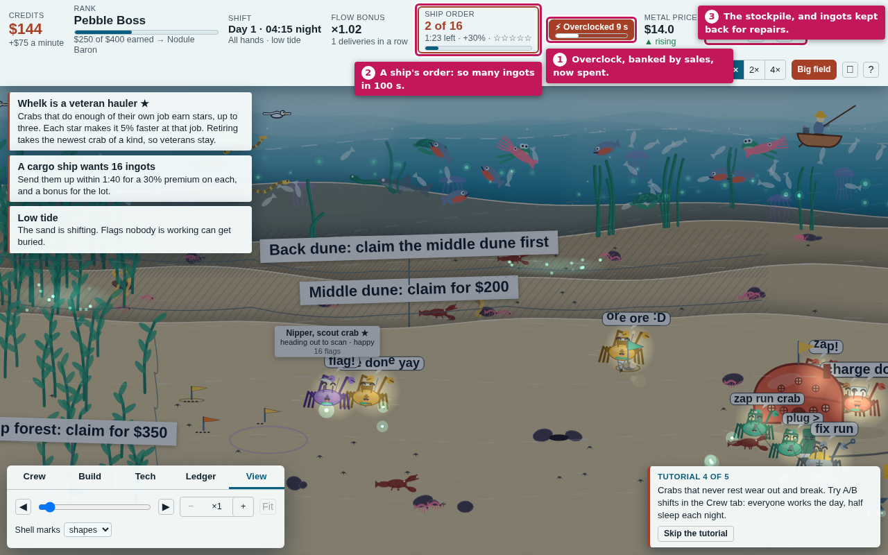

*The top bar during a ship's order, with overclock running.*

1. Overclock, banked by sales, now spent.
2. A ship's order: so many ingots in 100 s.
3. The stockpile, and ingots kept back for repairs.

The metal price centres on 12 credits an ingot and drifts between 6.6 and 18. Each sale within 6 s of the last adds 2% to the price, up to 40%: the flow bonus. Every sale also banks overclock; pressing ⚡ (or O) spends it and the whole crew works 50% faster, at the cost of more power and twice the wear. The tutorial's third step asks for this once 10 s are banked; here it shows "Overclocked 9 s". Cargo ships post orders: here 2 of 16 ingots sent with 1:23 left, each at a 30% premium. Filling one pays a bonus and a reputation star; missing one costs a star. From Ingot Magnate on, a rival crew of lobsters races you for every order, and its count shows beside yours. Contracts, surface news (booms, gluts and rumours), pearls, sunken chests and insurance are the other ways money moves (RULES.md, section 13).

**Check yourself**

- [ ] Spend overclock when the line is balanced and an order is open, not when one stage is starved.

## 5. The workday: shifts, rest and the night

**Why it exists.** Crabs that never rest wear out: after four minutes of work, breakdowns grow likelier and the crab slows, by up to a fifth. Nights are half speed for a crab that has not slept or danced. Shifts trade hours of work for rested, faster crabs.

**How it fits.** A shift pattern only works if every job has somebody on duty in every part of the day; a gap stops a stage. The advisor and the Ledger's coverage table name the first gap.

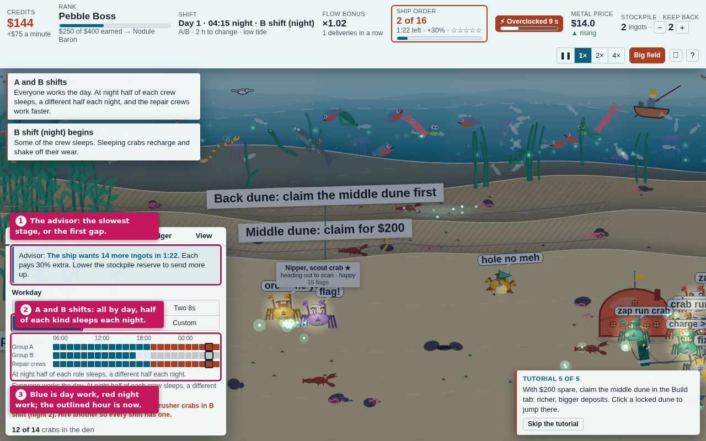

*A and B shifts, chosen in the Crew tab.*

1. The advisor: the slowest stage, or the first gap.
2. A and B shifts: all by day, half of each kind sleeps each night.
3. Blue is day work, red night work; the outlined hour is now.

There are six patterns: All hands, 8-hour day, two 8-hour shifts, A and B shifts, three-shift relief, and Custom (start hour, shift length, shifts a day, rest between, and groups). Under A and B, repair and maintenance bots work all night, 30% faster. Here the advisor had already moved on to the open order ("The ship wants 14 more ingots in 1:22"), and the gaps line warned that the crushers had nobody on duty in B shift's night.

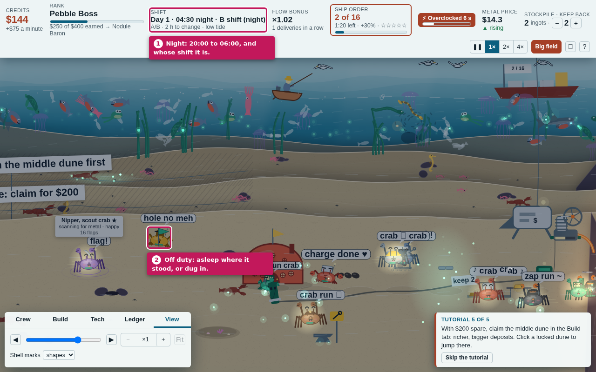

*The night under B shift.*

1. Night: 20:00 to 06:00, and whose shift it is.
2. Off duty: asleep where it stood, or dug in.

A day is 180 s and stands for 24 hours. A crab going off duty finishes its task and sleeps where it stands; a tired crab digs into the sand with only its eyes showing. Sleep recharges a crab's battery and sheds wear four times as fast as standing idle. Scouts are never slowed by the dark. Three patches of glowing plankton wander the dunes, and a tired crab inside one works at full speed; the lighthouse lamp (part 9) does the same at the field's edge. At each dawn, a crab that slept or danced at least 20 s the day before starts fresh, 25% faster for 90 s.

**Check yourself**

- [ ] After changing the pattern, read the gaps line under the timeline. "Not covered" means a stage will stop.

## 6. Upkeep: power, breakdowns and repairs

**Why it exists.** A line that only grows is a spreadsheet. Batteries run flat, drill bits snap, energy bots wear out and any crab can lose a leg, so part of the crew must keep the rest running, and part of the metal goes back into the line instead of up the riser.

**How it fits.** Upkeep is paid in metal and in crabs, never in credits: repair bots forge bits and energy cells from stockpile ingots, maintenance bots forge legs from bars, both in the lava. That is why the stockpile has a reserve (part 4) and why the advisor names power, repairs and legs before any production stage.

There is no picture of its own; it is in most of them. In picture 4 the refuel post stands on its extension cord from the Stirling engine, which lava heat drives (32 charges a minute, more with upgrades, double in a lava surge). Energy bots carry four charges, walk up to the crab with the lowest battery under 60% and pass the charge claw to claw, and plug back in at the post. The tide pushes the post along the sand, and a bot drags it back. Each hole risks a broken bit (4.5% of holes at first); a crab can lose a leg about once an hour of work and limps at 55% speed until a maintenance bot fits a new one. In picture 5 the tutorial's second step is waiting on exactly this: the hires the advisor named were an energy bot and a maintenance bot.

A crab whose own job is stuck first looks for someone to help: it holds a drill steady, carries beside a hauler, or runs hand in hand with an energy bot. Failing that, it takes the backup job, carrying nodules to the ore pile. Idle neighbours dance, which recharges them and sheds wear.

**Check yourself**

- [ ] If the advisor names repairs or legs, hire the fixer first: a broken crab slows its whole stage.
- [ ] Keep the reserve at 2 or more while there are drills; a repair with no ingot waits.

## 7. The sea joins in

**Why it exists.** "Mining is a gamble", in the introduction's words. The sea brings good and bad on its own timers, so no two runs are the same and a balanced line still has to react.

**How it fits.** Every visitor works through the same levers as the player: the octopus takes from the ore pile, the storm slows walking and the riser, the trader swaps metal for goods. The advisor puts the octopus and the trader at the top of its list, and every event raises a toast that says what it does.

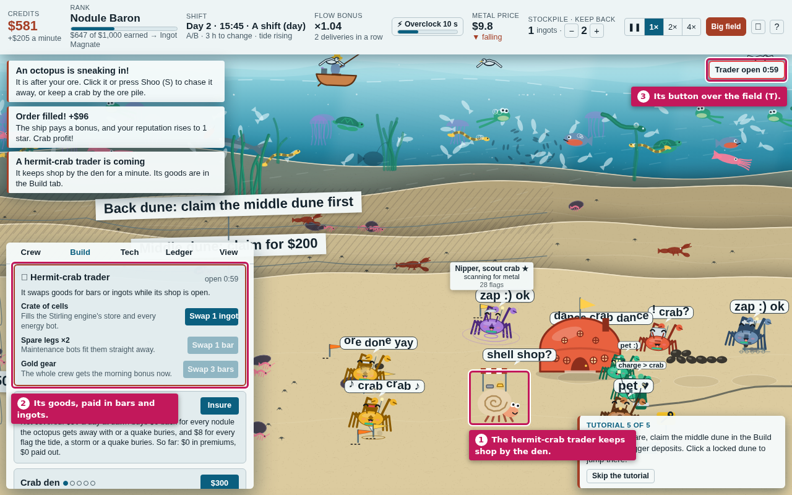

*The hermit-crab trader keeps shop by the den.*

1. The hermit-crab trader keeps shop by the den.
2. Its goods, paid in bars and ingots.
3. Its button over the field (T).

The trader comes at 240 s and then every four to six minutes, keeps shop for 60 s, and offers three of seven goods. On this visit: a crate of cells (fills the engine and every energy bot, 1 ingot), spare legs (1 bar) and a gold gear (the morning bonus for every crab at once, 3 bars). A toast above records the first order filled: +$96, and a reputation star. On a festival's eve it holds a night market till dawn with a cake on the counter.

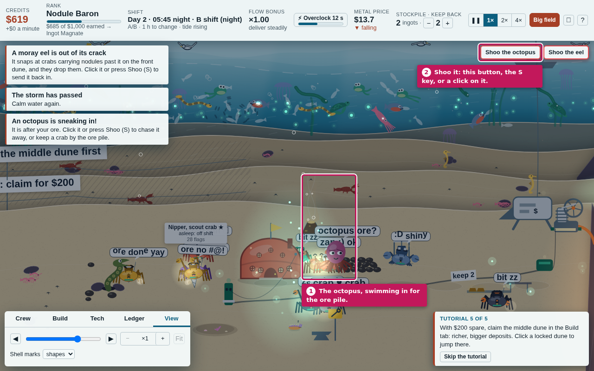

*The octopus, on its way to the ore pile.*

1. The octopus, swimming in for the ore pile.
2. Shoo it: this button, the S key, or a click on it.

The octopus grabs up to two nodules unless a crab is within 28 units of its target. Here the moray eel was out of its crack too, with its own Shoo button: it makes a crab carrying nodules past it drop them. Both buttons exist so that nothing on the field needs a mouse.

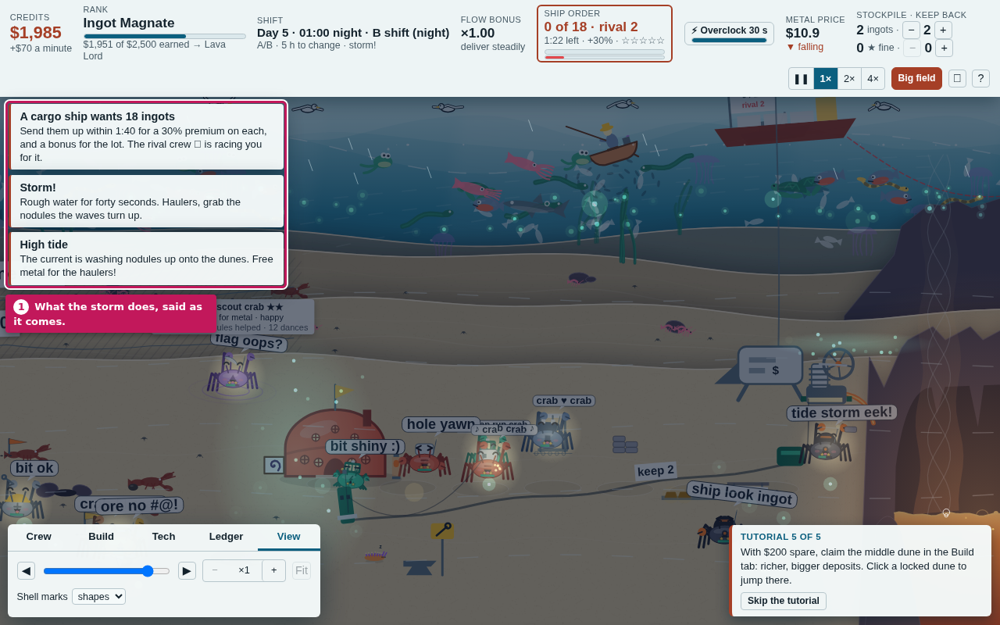

*A storm, and what it does, said as it comes.*

1. What the storm does, said as it comes.

A storm comes with a 20-second warning and lasts 40 s: walking slows to 85%, the riser to half speed, and idle flags can be buried, but the waves stir up free nodules. Here a ship's order for 18 ingots arrived in the same minute, with the rival crew racing for it. The rest of the sea: tides that wash nodules up and bury flags, lava surges that halve smelting time, a sea turtle and a manta ray that give crabs lifts, earthquakes, a hydrothermal chimney to ride, whales, and a closed food web of fish, hunters, gulls and a fisherman that touches the game in only two ways (the shark can chase the octopus off; a gull can snatch a nodule from a crab on the back dune's crest).

**Check yourself**

- [ ] When the Shoo button appears, press S. A crab standing by the ore pile does the same job.

## 8. Growing: the Build and Tech tabs

**Why it exists.** Hiring alone hits walls: the den's room, the front dune's poorer deposits, the speed of one riser. Upgrades and research move those walls, and each one is a decision about which stage to help.

**How it fits.** Upgrades change the world (more ground, more room, faster machines, new buildings); research unlocks worker upgrades that change every crab of one kind. Both are paid in credits, so they compete with hiring.

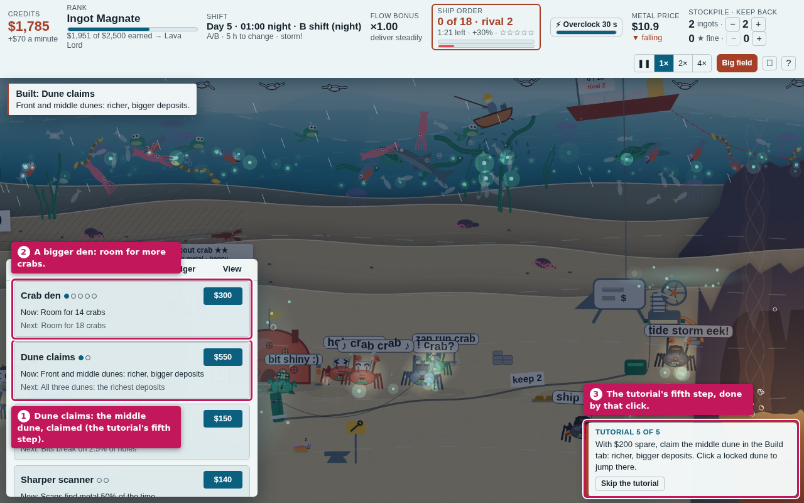

*The Build tab, after the tutorial's fifth step.*

1. Dune claims: the middle dune, claimed (the tutorial's fifth step).
2. A bigger den: room for more crabs.
3. The tutorial's fifth step, done by that click.

The middle dune costs 200 and the back dune 550; deeper dunes have richer, bigger deposits. In this run the middle dune was bought on day 5, at about 865 s of crab time, with $1,985 in the bank. The Build tab also holds Move buildings (tap a building, then a plot), the plots in order with ◀ ▶ buttons, the refuel post's pin, the den's decorations, the trader's goods, a contract on offer, and Insure.

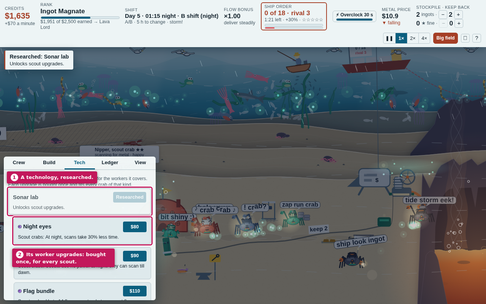

*The Tech tab, with the Sonar lab researched.*

1. A technology, researched.
2. Its worker upgrades: bought once, for every scout.

Five technologies (Sonar lab, Metallurgy, Hydraulics, Power electronics, Field engineering) unlock twenty worker upgrades, from Night eyes (scans 30% quicker at night) to Tough joints (every crab loses legs half as often). Everything costs 4,450 credits in total.

**Check yourself**

- [ ] Before buying an upgrade, name the stage it speeds up. If it is not the slowest one, hire instead.

## 9. The late game: more ground, a longer line

**Why it exists.** Once the crew is balanced, the line's geometry becomes the limit: walks from the field to the pile, from the bar stack to the lava, and nights. The late upgrades shorten those walks and light the dark.

**How it fits.** Each one strengthens a particular stage, and the Ledger's capacity estimate counts them (the conveyor makes haulers 30% stronger, the annex 15%, the second rim smelters 10%).

*Simulated: 6,000 credits were added here, and the upgrades were bought through `crabminer.sim.buy()`. The wreck came on its own timer once the back dune was claimed.*

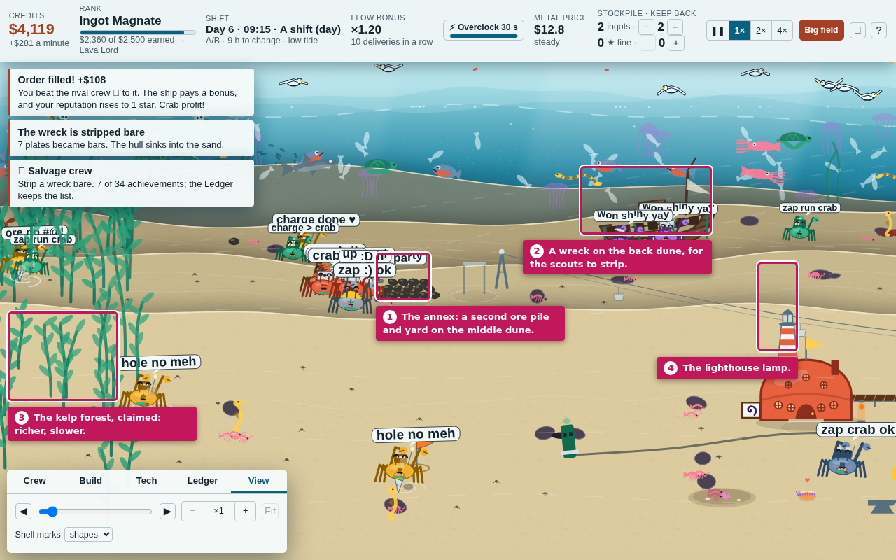

*The left of the field in the late game.*

1. The annex: a second ore pile and yard on the middle dune.
2. A wreck on the back dune, for the scouts to strip.
3. The kelp forest, claimed: richer, slower.
4. The lighthouse lamp.

The annex puts a second ore pile and crushing yard among the deep deposits; haulers choose the nearer pile, crushers follow the ore, and bars ride a cableway down to the bar stack. The wreck holds 6 to 10 metal plates; scouts prise them off and carry them to the bar stack as bars. The toasts in this picture record the first one stripped bare ("7 plates became bars", and the Salvage crew achievement) and an order won from the rival crew. The kelp forest at the field's left end has richer deposits but slows every step to 70%. The lighthouse lamp lights 120 units (220 at its second level) at night, where a tired crab works at full speed.

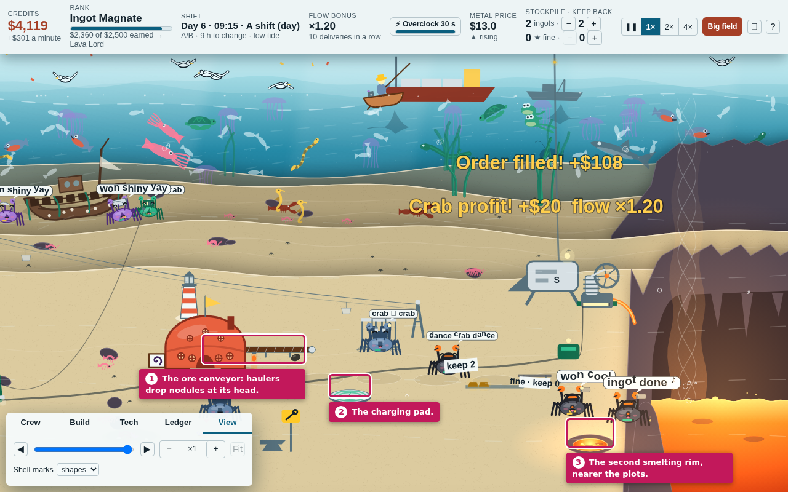

*The right of the field in the late game.*

1. The ore conveyor: haulers drop nodules at its head.
2. The charging pad.
3. The second smelting rim, nearer the plots.

Haulers queue at the conveyor's head instead of the pile, and the belt carries the nodules on at 60 units a second. Crabs near the charging pad charge themselves while they work or wait. The second rim is a pocket of lava 34 units nearer the bar stack; smelters spread themselves over both rims, and the repair crews forge there. The rulebook gives the numbers: in a 20-minute run with smelting the slowest stage, output rose from 13.4 to 15.0 ingots a minute.

## 10. The crabs' lives: festivals, pets, moods and talk

**Why it exists.** The crabs are the reason to watch. Rest, dancing and a homely den are also mechanics: they recharge batteries, shed wear, and give the morning bonus, so caring for the crew is part of playing well.

**How it fits.** Every tenth day is a festival that doubles the flow bonus all day; moods make happy crabs dance from further off and grumpy crabs 5% slower; decorations add to the morning bonus. Pets and crab talk are pure charm and change nothing.

*Simulated: the festival and the four pets were called up with `crabminer.festival()` and `crabminer.adopt()`.*

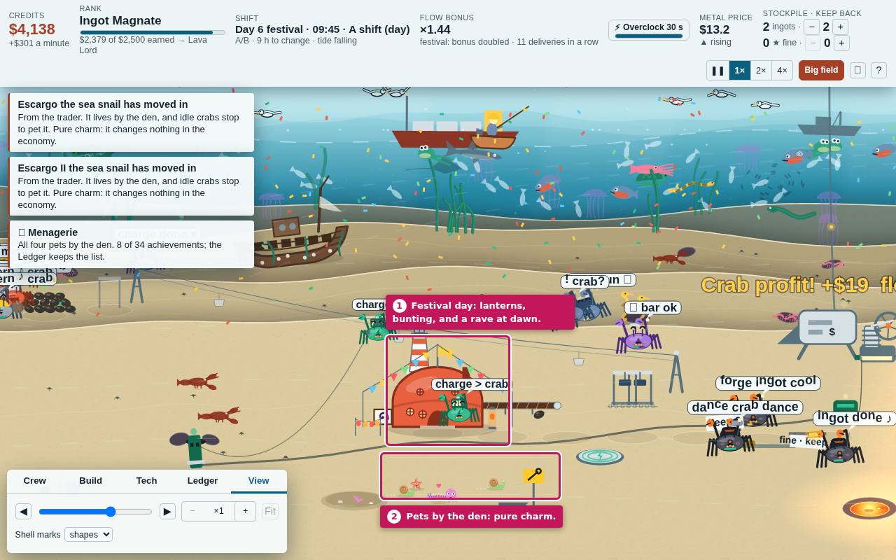

*Festival day at the den.*

1. Festival day: lanterns, bunting, and a rave at dawn.
2. Pets by the den: pure charm.

At a festival's dawn every crab starts fresh, the crabs rave for 20 s, bunting hangs from the den's flagpole, and the den gets a string of lanterns. The top bar says "festival: bonus doubled". Pets move in at Nodule Baron (a sea slug) and Lava Lord (a baby octopus), and the trader sells a starfish and a sea snail; idle crabs stop to pet them. Every 300 crab-seconds of idle time, the idle crab nearest the den makes it a decoration, and big moments inspire special ones (a storm's driftwood sculpture, a trophy for a rank-up). The crabs talk in emoji sentences, 58 kinds of talk in 117 phrasings, and have 119 animations.

## 11. The Ledger: finding the slowest stage

**Why it exists.** Watching the field tells you something is wrong; the Ledger tells you what. It turns the simulation's own state into tables: what each stage could do, who covers which hours, where the money went.

**How it fits.** The advisor's one line comes from the same numbers. The Ledger is where a player checks the advisor and plans the next hire, upgrade or shift.

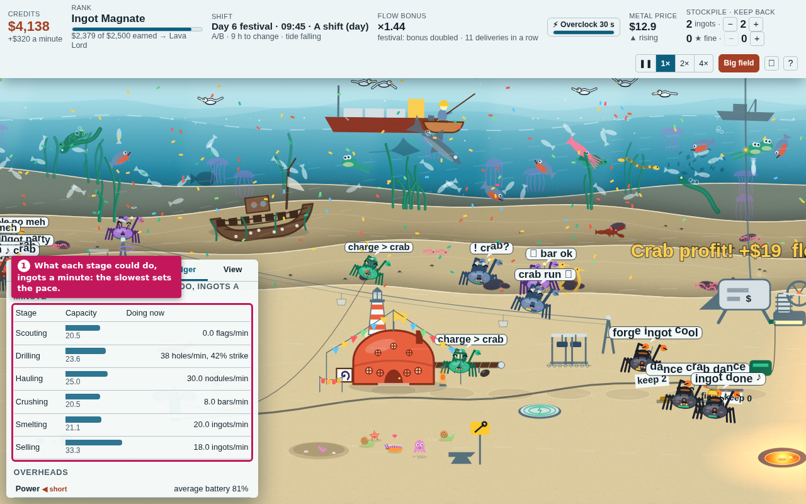

*The line: what each stage could do, ingots a minute.*

1. What each stage could do, ingots a minute: the slowest sets the pace.

Here, with 20 crabs on all three dunes, scouting and crushing could each do about 20.5 a minute and smelting 21.1, against selling's 33.3; the overheads below said power was short. The Ledger also holds a run summary to copy, whole-game charts of money and output, the price, the coverage table for shifts, the sea's events, bonuses, crab talk by count, and the food web's lab report.

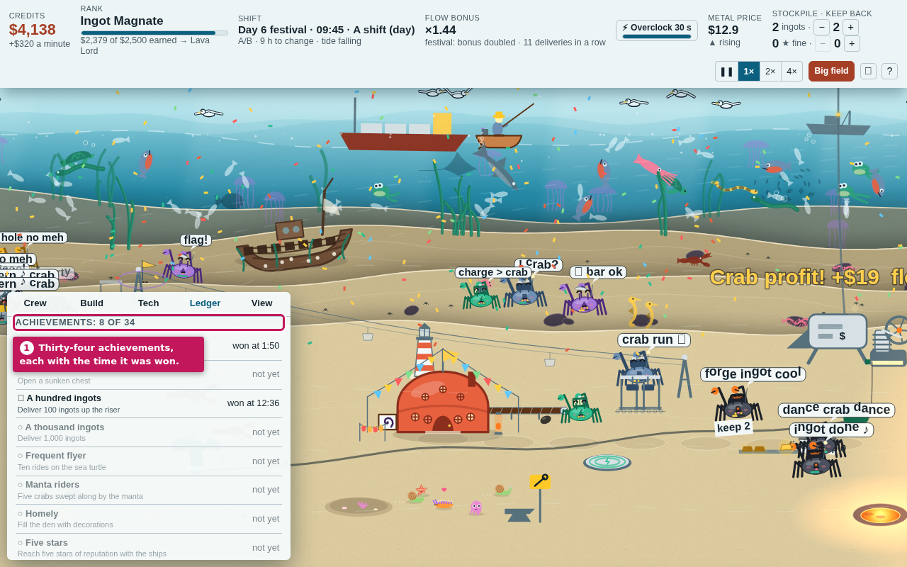

*Achievements: thirty-four, each won once.*

1. Thirty-four achievements, each with the time it was won.

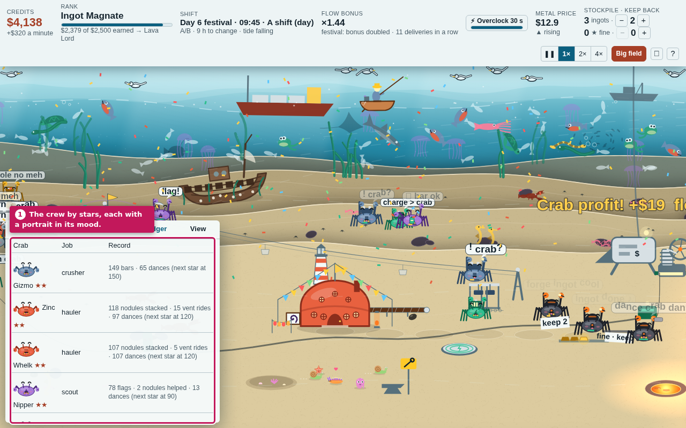

*The crew table: portraits in their moods.*

1. The crew by stars, each with a portrait in its mood.

**Check yourself**

- [ ] Compare the two smallest bars in "The line". If they are close, help both; if one is far below, hire only for it.

## 12. Crab Tycoon, and a new dig site

**Why it exists.** A goal and a score give the run a shape: reach Crab Tycoon (6,000 lifetime credits), and the crab time it took is your score, with the best time kept in the browser. A new dig site gives a reason to play again without starting from nothing.

**How it fits.** The six ranks (Sand Scraper, Pebble Boss, Nodule Baron, Ingot Magnate, Lava Lord, Crab Tycoon) each pay a bonus of a tenth of their threshold, and some unlock things on the way: pets, the rival crew.

*Simulated: lifetime earnings were set to 5,990 here, so the next sale made Crab Tycoon.*

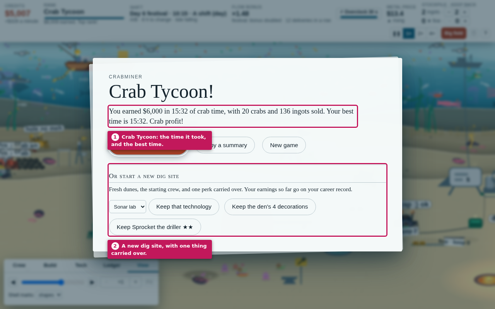

*The win card.*

1. Crab Tycoon: the time it took, and the best time.
2. A new dig site, with one thing carried over.

Here: $6,000 in 15:32 of crab time, with 20 crabs and 136 ingots sold (a time shortened by the credits added in part 9, so not a real score). A new dig site has fresh dunes, the starting crew and one perk carried over: a technology you researched, the den's decorations, or your best crab with its name, record and stars. The Ledger's Career note keeps the sites before it. You can also keep playing.

## 13. The paper under the game, and the controls

**Why it exists.** The rules are written down in full, under the game, as an IEEE-style article with a review of the economy, so a player can read why the numbers are what they are; and every action has a key or a button as well as a click, so the game can be played without a mouse.

**How it fits.** The paper is checked against the same deterministic simulation the page runs, and Listen all reads it and the introduction aloud.

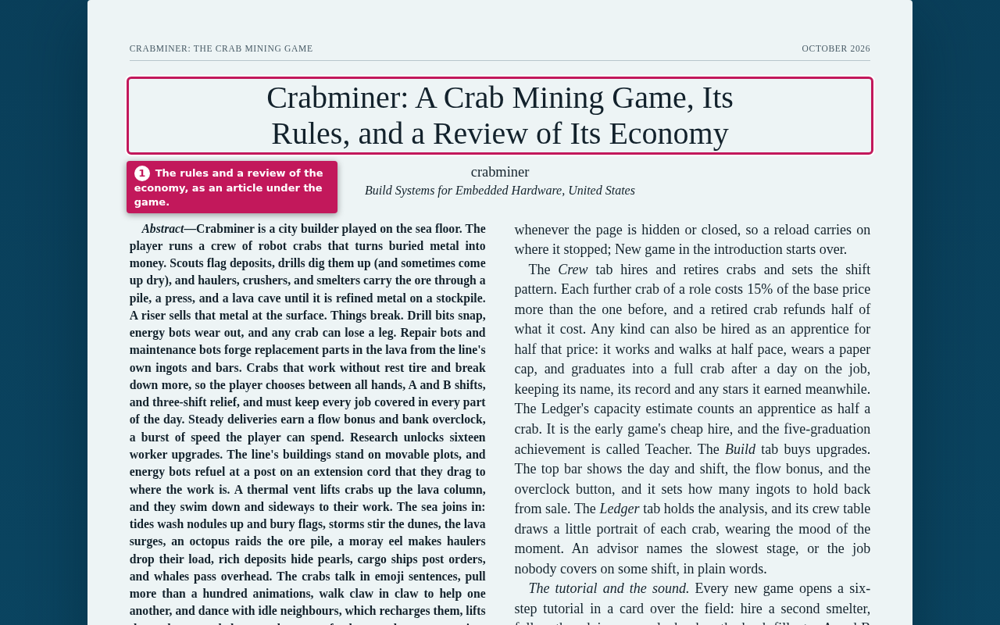

*The paper under the game.*

1. The rules and a review of the economy, as an article under the game.

Keys: Space pauses, 1 2 3 set the speed, O overclocks, S shoos the octopus or the eel, T opens the trader, C the contract on offer, N toggles sound, M moves buildings, [ and ] switch tabs, B switches between the big field and the side panel, + − 0 zoom, and ? opens the introduction. On a touch screen, drag to pan, pinch to zoom, and hold a finger on a crab to keep its card open. The View tab sets the shell marks: shapes, letters, or none.

## 14. How it fits together

**Why it exists.** Crabminer is one line, from sand to ship, run by crabs that each follow a simple rule; the player's job is the balance.

**How it fits.** Each part exists because the part before it is not enough on its own.

| Stage | Feature | Why it is not enough alone |
| --- | --- | --- |
| Learn | The introduction, the tutorial, the advisor | They name the next step; they do not say why the line is slow. |
| Produce | Scouts, drills, haulers, crushers, smelters, the riser | The slowest stage sets the pace; more of a fast stage adds nothing. |
| Keep running | Energy bots, repair and maintenance bots, the reserve | Upkeep costs metal and crabs that do not produce. |
| Rest | Shifts, sleep, dancing, the morning bonus, plankton and the lamp | Rested crabs are faster, but a shift with a gap stops a stage. |
| Sell | The price, the flow bonus, overclock, orders, the rival, contracts | Selling well needs a steady line behind it. |
| Grow | The Build and Tech tabs, the late upgrades, the annex | Every upgrade helps one stage; the wrong one is wasted credits. |
| React | The sea's visitors, weather and the food web | Each is a short shock to a balanced line; the toasts and the advisor say what to do. |
| Measure | The Ledger: capacity, coverage, money, achievements | Numbers, not orders: the player still decides. |
| Finish | Crab Tycoon, the best time, a new dig site | The score is the crab time; a new site starts the balance again. |
